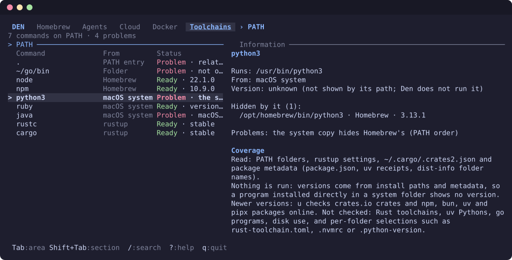
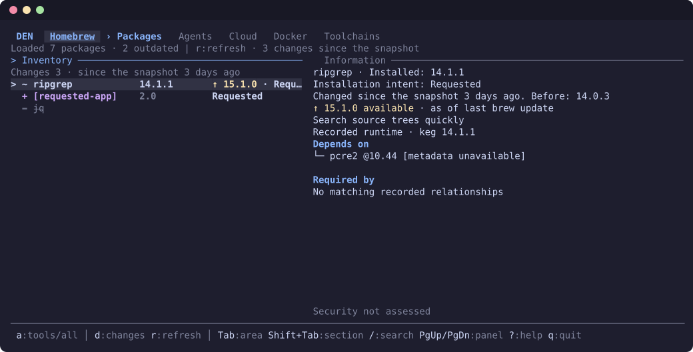
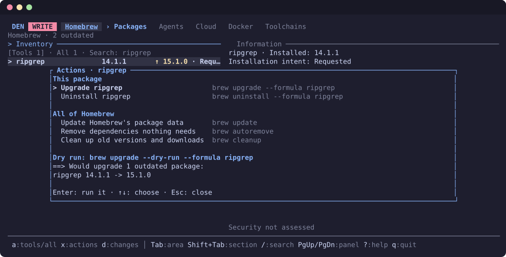

# Den

[](https://github.com/fran0x/den/actions/workflows/ci.yml)
[](https://crates.io/crates/den-tui)
[](#license)

**A terminal inspector for your developer machine.** Two commands:

- **`den`** shows what is installed and how it is configured. It never changes anything.
- **`dew`** is the same, plus a few clean-up actions you choose and confirm.

## Install

```sh
brew install fran0x/tap/den      # Homebrew: installs den and dew
cargo install --locked den-tui   # or from crates.io (Rust 1.90+)
```

Or download a binary for macOS or Linux from
[Releases](https://github.com/fran0x/den/releases). `brew` and `docker` are optional: an
area whose tool is missing says so.

## den: read-only



| Area | What you see |
| --- | --- |
| **Homebrew** | Packages you asked for, what depends on what, newer versions, leftovers |
| **Agents** | Codex and Claude Code side by side: skills, instructions, settings, MCP, hooks, plugins |
| **Cloud** | AWS profiles (active one first) and Kubernetes contexts |
| **Docker** | Containers, images, volumes and reclaimable space |
| **Toolchains** | Which `node`, `python3` or `cargo` wins on PATH; rustup, cargo, npm, uv, pipx, bun and go installs |

When something is wrong, the panel beside the row says why.

**What it promises:**

- Runs only a fixed set of read commands (`brew info`, `docker container ls`, …); the
  rest comes from files.
- Never calls AWS, a cluster, an MCP server, a hook or anything it finds on PATH.
- Goes online only when you press `u` and confirm, and then sends only package names.
- Never shows secrets: tokens, keys and credential values are dropped as they are read.
- Writes nothing, except its own snapshot and online results, each after you confirm.

**What changed:** after a refresh, `+` marks new rows and `~` changed ones, and `d` lists
only those plus what was removed. Den compares with how it first read each area, and with
the snapshot you last saved with `S` (`~/.local/state/den/snapshot.json`), so the next run
shows what changed since.



**Newer versions online:** `u` asks Homebrew, crates.io, npm, PyPI, Docker Hub, ghcr.io and
endoflife.date what is newer than what you have: packages, builds of your Docker images,
Rust toolchains and the runtimes on PATH. Newer ones are marked `↑`, and a release line
whose support has ended **End of life**. Den asks before it sends anything, sends only
names, and keeps the answers with the time of the check.

**Keys:** `Tab` areas · `Shift+Tab` sections · `/` search · `d` changes · `S` snapshot ·
`u` check online · `?` help · `q` quit.
Try it without reading your machine: `den --demo`.

## dew: with changes



`dew` shows WRITE in the top bar. Select a row, press `x` to see its actions, then `Enter`
to run the selected one.

| Area | Actions |
| --- | --- |
| **Homebrew** | Upgrade, uninstall, update Homebrew's data, remove unneeded dependencies, clean up |
| **Docker** | Stop a running container; remove a stopped container, or an image or volume nothing uses |
| **Toolchains** | Update or uninstall a Rust toolchain; upgrade or uninstall a crate, or a global npm, uv tool or pipx package; Homebrew's actions for a command it installed |

**What it promises:**

- Shows the exact command first, and Homebrew's dry run where there is one.
- Refuses what is in use: no uninstall while something needs the package, no removing a
  used image or volume, the default toolchain or one a folder override uses.
- Never uses `--force`, `prune`, a shell or sudo. `Esc` stops a running action.
- Logs each action to `~/.local/state/den/actions.log` (time, command, result).

## More

- [Guide](docs/GUIDE.md): every area, key and action in detail.
- [Security policy](SECURITY.md): what Den may read and run; report issues privately.
- Develop: `just check`, `just smoke`, `just ci`. Rules are in [AGENTS.md](AGENTS.md).

## License

[Apache License 2.0](LICENSE-APACHE) or [MIT](LICENSE-MIT), at your option.
Contributions are accepted under the same terms.
