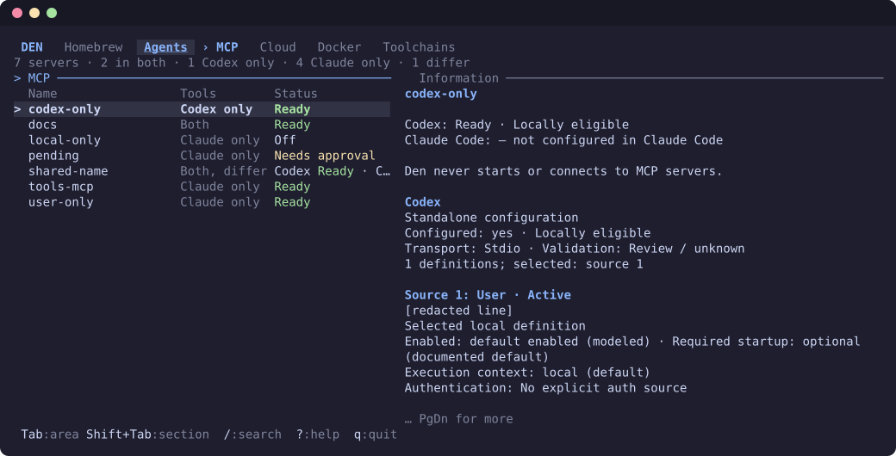
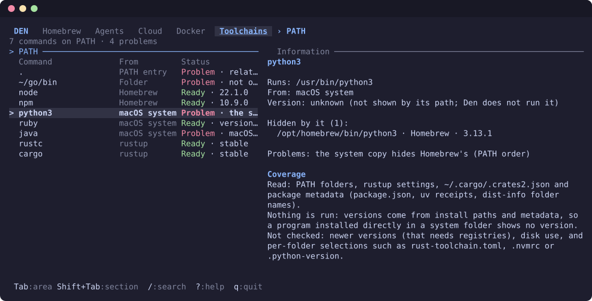
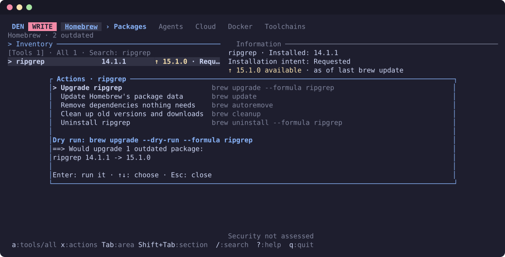

# Den

[](https://github.com/fran0x/den/actions/workflows/ci.yml)
[](https://crates.io/crates/den-tui)
[](#license)

**A terminal inspector for your developer machine, read-only by default.**

Den shows what is installed and how it is configured: Homebrew packages and their
dependencies, Codex and Claude Code side by side, cloud profiles, Docker and language
toolchains. `den` only reads: it never installs, removes, logs in or runs what it finds.
`dew` is the same tool with changes allowed: upgrade, uninstall and clean up Homebrew
packages, and stop or remove Docker containers, images and volumes nothing uses. Each one
is chosen by you and shows what it will do first.



## Install

```sh
cargo install --locked den-tui   # installs both commands
den                              # read-only
dew                              # the same, with changes allowed
```

Or download a binary for macOS or Linux from
[Releases](https://github.com/fran0x/den/releases). Building from source needs Rust 1.90 or
newer. `brew` and `docker` are optional: an area whose tool is missing says so.

## What it shows

| Area | Sections | At a glance |
| --- | --- | --- |
| **Homebrew** | Packages · Diagnostics | Tools you asked for, what depends on what, newer versions, missing and leftover packages |
| **Agents** | Skills · Instructions · Settings · MCP · Hooks · Plugins | Codex and Claude Code compared row by row, with one status vocabulary |
| **Cloud** | AWS · Kubernetes | AWS profiles and SSO sessions; kubeconfig contexts, how each signs in, and what is broken |
| **Docker** | Containers · Images · Volumes | State, usage and reclaimable space, refreshed while you watch |
| **Toolchains** | PATH · Rust · Packages | Which `node`, `python3` or `cargo` wins and from where; rustup toolchains, `cargo install`, npm, uv, pipx, bun and go globals |

Every row has a status, and when something is wrong the panel beside it says why: a role
chain that loops, a context whose cluster is gone, a `java` that is only a macOS stub, a
system `python3` hiding Homebrew's.



## Read-only by default

- **Fixed commands only.** `den` runs `brew info`, `missing`, `leaves` and
  `autoremove --dry-run`, and `docker container ls`, `image ls`, `volume ls` and
  `system df`. Each is bounded in time and output, and everything else is read from files.
  Homebrew may refresh its own metadata when asked.
- **Nothing is called.** No AWS API, cluster, `kubectl`, exec plugin, credential helper,
  MCP server, hook or program found on PATH is ever run.
- **Secrets stay put.** Credential values, tokens, keys, server hosts and URLs are dropped
  as they are read or kept only as "set". Untrusted text is sanitized before display.
- **Unknown stays unknown.** Den reports evidence, never guesses: no count means "not
  recorded", not "safe to remove".
- **Writes are opt-in.** `den` never changes anything and offers no actions. In `dew` (the
  top bar shows WRITE), `x` shows the actions and `Enter` runs the one you choose: in
  Homebrew `brew upgrade`, `uninstall`, `update`, `autoremove` or `cleanup` after its dry
  run; in Docker `docker container stop`, `container rm`, `image rm` or `volume rm` on
  something nothing uses. Never with `--force`, `prune`, a shell or sudo.



Per-area details are in the [guide](docs/GUIDE.md#what-den-reads-and-what-it-never-does);
actions are in [Making changes](docs/GUIDE.md#making-changes).

## Use

`Tab` switches areas, `Shift+Tab` sections, `/` searches, `?` shows help for where you
are and `q` quits. [The guide](docs/GUIDE.md) covers each area and its extra keys.

To upgrade, uninstall or clean up Homebrew packages, run `dew` instead of `den`: see
[Making changes](docs/GUIDE.md#making-changes).

To look around first without Den reading anything on your machine:

```sh
den --demo
```

| Flag | Effect |
| --- | --- |
| `--project DIR` | Project for Agents (default: the current folder) |
| `--codex-profile NAME` | Inspect `$CODEX_HOME/NAME.config.toml` |
| `--skills` | Start in Agents; Homebrew loads when opened |
| `--demo` | Built-in sample data; nothing on this machine is read |
| `--help` | All flags, including the offline sources |

## Develop

```sh
just check    # format, Clippy, tests, release build
just smoke    # offline terminal checks in a real PTY
just ci       # everything CI runs (needs cargo-deny and Rust 1.90; see `just tools`)
```

From a checkout, `just den` starts Den, `just dew` starts it with writes allowed, and
`just fixtures` lists synthetic setups for every area (Codex and Claude Code, AWS,
Kubernetes, Docker, toolchains) that never touch your machine. CI runs on Ubuntu and
macOS, and `cargo deny` checks dependencies for advisories, licenses and sources. Live
checks against your own machine are opt-in (`just live`). Contributor rules, including
what Den may run and read, are in [AGENTS.md](AGENTS.md).

## License

Licensed under either of [Apache License 2.0](LICENSE-APACHE) or [MIT](LICENSE-MIT), at
your option. Contributions are accepted under the same terms. Report vulnerabilities
privately; see the [security policy](SECURITY.md).
